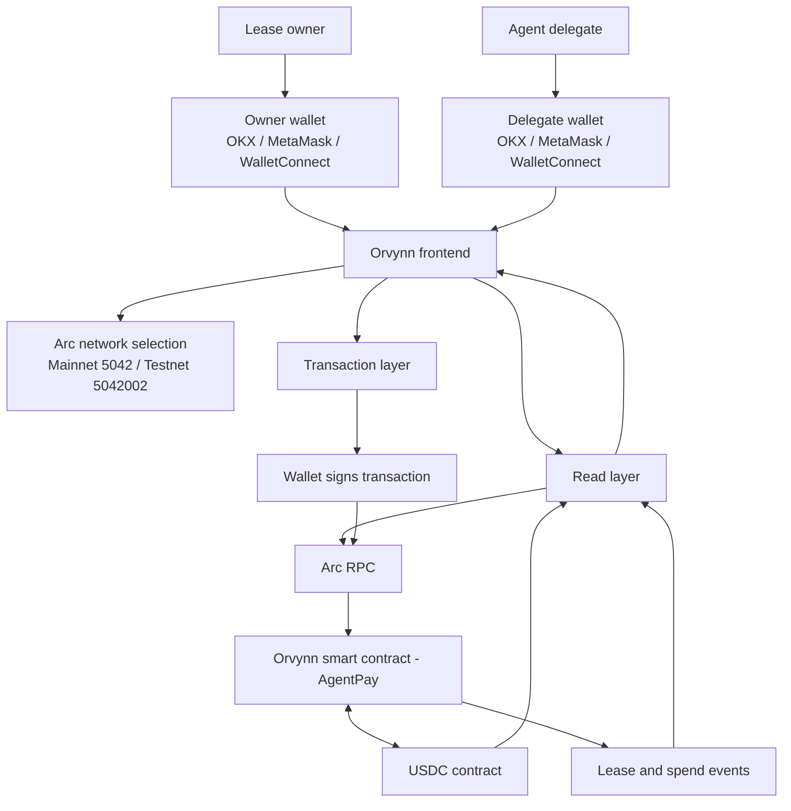

# Orvynn Architecture

Orvynn is a non-custodial interface for creating and managing USDC spending leases for AI-agent delegates on Arc.

## System overview

## Main responsibilities

- **Owner wallet:** creates leases, funds them, updates recipient restrictions, revokes leases and withdraws remaining funds.
- **Delegate wallet:** submits spend transactions within the lease's on-chain permissions and available balance.
- **Orvynn frontend:** presents lease, wallet and activity information; prepares transactions and requests wallet signatures.
- **Read layer:** reads contract state, USDC balances and contract events from Arc RPC.
- **Transaction layer:** submits wallet-signed calls to the Orvynn contract and waits for confirmed receipts before refreshing the interface.
- **Orvynn smart contract (named AgentPay):** enforces delegate identity, spending caps, lease duration, recipient restrictions and owner-only controls.
- **USDC:** the token held and transferred by the lease contract.

## Important transaction boundaries

1. Funding uses USDC approval followed by a separate lease deposit.
2. A lease's spending cap and deposited balance are separate limits.
3. Revoking a lease stops future delegate spending; it does not automatically withdraw the remaining balance.
4. The owner must submit a separate withdrawal transaction to recover the remaining balance.
5. Transactions are signed by the user's wallet. Orvynn does not receive or store wallet private keys.

## Network configuration

| Network | Chain ID |
| --- | ---: |
| Arc Mainnet | 5042 |
| Arc Testnet | 5042002 |

The configured USDC token uses 6 decimals. The deployed Arc Mainnet Orvynn contract (AgentPay) is `0xA549B60313A86288d46323e5723AAa4c0fAA6363`.

## Security scope

The contract's rules are enforced on-chain. Frontend checks and transaction simulations improve the user experience but do not replace contract enforcement or an independent security audit. Foundry test success is not a professional audit.
